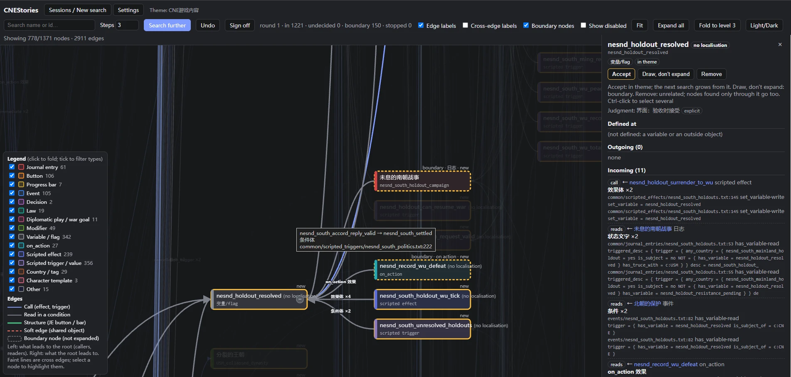
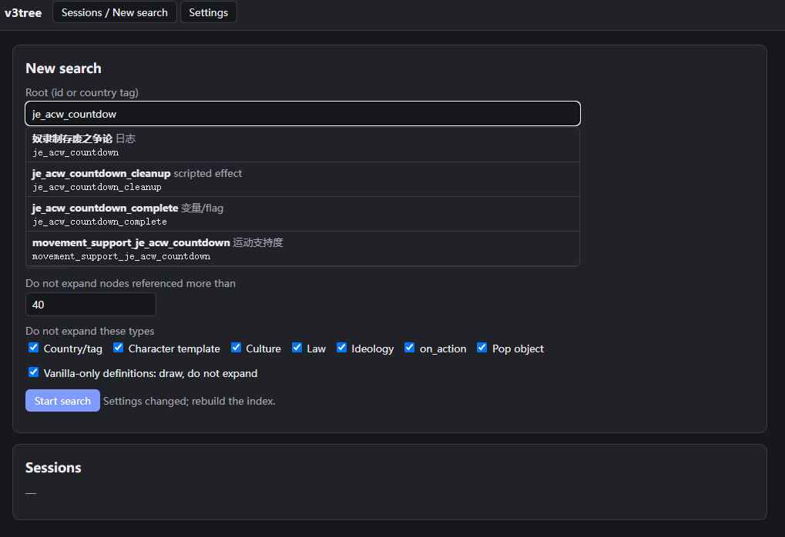

# v3tree: content maps for Victoria 3 mods

[中文说明](README.zh-CN.md)

Give v3tree a journal entry, event or decision (or a country tag). It finds the script content in your mod and the game that connects to it, and draws an interactive map you open by double-clicking. Every line on the map points to the file and line it came from.

It is for modders who have lost track of a large system: chains rewritten many times, or code written by others or by an AI.



- **Mechanical, traceable index.** Parses the game and any number of mods in load order. Calls, condition reads, buttons, progress bars, variables, modifiers, laws, pops… each edge carries file:line. What it cannot resolve is listed, never guessed.
- **You decide the boundary.** A map needs to know what belongs to your theme. Do it by hand in a local web page (search N steps, accept / draw-only / remove, search further, sign off), or let an AI agent judge every neighbour with a written reason.
- **Checks itself.** Every report re-checks 10 random edges against the source, searches the raw text for references the index missed, and lists suspected problems (variables written but never read, events nothing fires, effects only shown in tooltips…).
- **Offline, no dependencies.** Python 3.10+ standard library only. The map is one HTML file.

## Before you start

- **Languages.** The interface and reports are in English and Chinese. The map shows `english` and `simp_chinese` localisation; other languages are untested. If you work in another language, ask your AI agent to add it. The interface language and the localisation languages are two separate settings, and names and type labels are stored when the index is built: after changing either, **rebuild the index**.
- **What it maps.** Script content only: journal entries, events, decisions, triggers, effects, variables, modifiers, laws, pop moves, flag definitions and the like. It does not read GUI files, the map, buildings or production methods, and it does not run the game. Don't expect it to pick up everything; see [Limitations](docs/en/limitations.md).
- **Performance.** Maps with many links (roughly 1,000+ nodes, or nodes with heavy fan-out) lag in the browser. Be patient, as we all are with Victoria 3 itself, or fold levels and filter types to lighten the map.

## Install

Python 3.10 or newer. Download or clone this repository. That is all; there is nothing else to install.

Run commands from the repository folder as `python run.py <command>`. Optional: `pip install -e .` gives you a `v3tree` command that works anywhere.

## Use it in the browser (no AI needed)

1. Double-click `start.bat` (Windows) or run `./start.sh` (macOS/Linux). Your browser opens.
2. **Settings:** the game install folder and/or your mod folder(s); at least one is required. "Import from launcher" reads your active playset in load order. Save, then **Build index** (10–30 seconds).
3. **New search:** type an id (autocomplete helps) or a country tag, choose the number of steps (1–10), keep or change the stop rules, **Start search**.

   
4. Click nodes to see their code, file:line and every connection. **Accept**, **Draw, don't expand** or **Remove**; Ctrl-click to select several. **Search further** grows the tree from accepted and undecided nodes. **Undo** steps back.
5. **Sign off:** the map, a report and a JSON file are saved in `output/cases/<name>/`. `map.html` opens by double-click, offline.

## Use it with an AI agent

Open the repository folder in Claude Code, Codex or a similar agent and say what you want, e.g. "map the X journal entry; my game is at … and my mod at …". The agent follows [AGENTS.md](AGENTS.md): it sets up and checks the configuration, asks for the root and theme, asks about boundaries (each with an explanation and a default), then judges every neighbour into `decisions.txt` with reasons.

## Command line

```bash
python run.py init                                  # first-time setup (asks questions), then a check
python run.py index                                 # build the index
python run.py search je_acw_countdown --steps 5     # automatic map with stop rules
python run.py new acw je_acw_countdown "The ACW countdown and the war"   # a case to judge
python run.py expand acw                            # list undecided neighbours
python run.py render acw                            # map.html + report.md + subgraph.json
python run.py serve                                 # the web interface
```

`examples/vanilla-acw/` holds a first round of judgments for the vanilla ACW countdown. Copy it to `output/cases/acw_example/` and run `expand acw_example`.

## Documents

- [Configuration and the startup check](docs/en/config.md)
- [Judging guide](docs/en/judging-guide.md)
- [How it works](docs/en/how-it-works.md): override rules, what the index records, the report
- [Limitations](docs/en/limitations.md)

## Tests

```bash
python -m unittest discover -s tests
```

The tests build a tiny synthetic game and two mods in a temporary folder; no Paradox files are included in this repository.

## Licence and credits

MIT, see [LICENSE](LICENSE). The script parser (`src/v3tree/clausewitz.py`) comes from the development tools of the *Neo-Era Southern and Northern Dynasties* mod. Victoria 3 is a trademark of Paradox Interactive; this project is not affiliated with Paradox.
