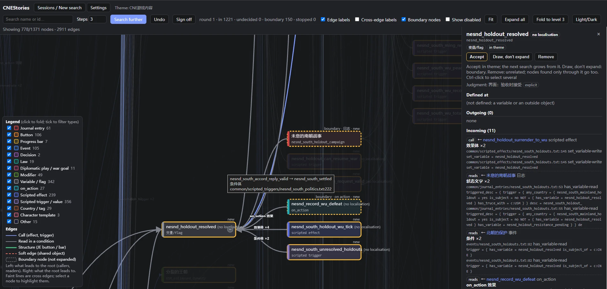
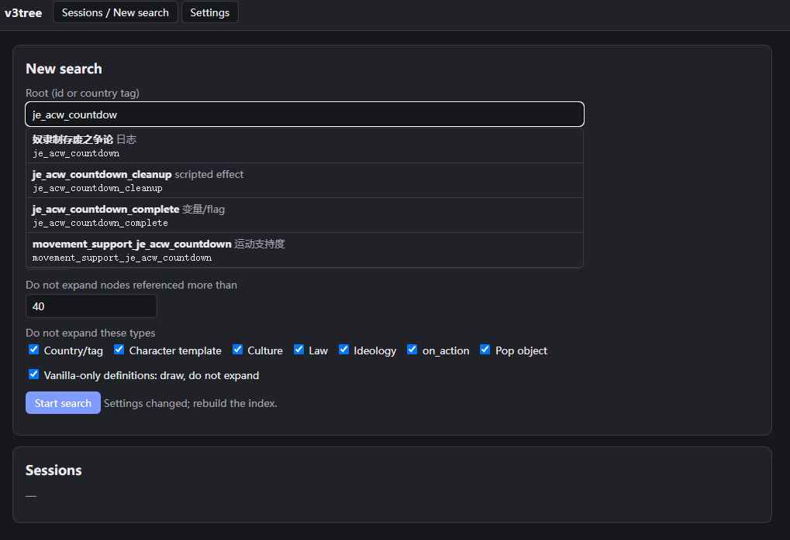

# v3tree：维多利亚3 MOD 内容关系图

[English](README.md)

给 v3tree 一个日志（JE）、事件或决议的 id（或一个国家 tag），它会找出 MOD 和原版里与之相连的脚本内容，画成一张双击就能打开的交互式关系图。图上每一条线都能追到出处的文件和行号。

适合手上有大系统、已经理不清的制作者：多次改写的日志链，或者别人、AI 写的代码。



- **机械抓取，可追溯。** 按加载顺序读取原版和任意多个 MOD。调用、条件读取、按钮、进度条、变量、修正、法律、人口……每条边都带文件和行号。解析不了的列出来，不猜。
- **边界由你决定。** 一张图需要知道哪些属于你的主题。可以在本地网页里手动做（往外找 N 步，接受 / 只画不展开 / 去掉，再继续找，最后验收），也可以交给 AI，让它逐个判定并写下理由。
- **自带核对。** 每份报告随机抽 10 条边回原文件核对，在原文里反查索引漏掉的引用，并列出疑似问题（只写不读的变量、没人触发的事件、只在提示里显示的效果等）。
- **离线，无依赖。** 只用 Python 3.10 以上的标准库。图是一个 HTML 文件。

## 开始之前

- **语言。** 界面和报告只有中文和英文。图上显示 `simp_chinese` 和 `english` 本地化；其他语言没有测试过。如果你的 MOD 用别的语言，可以让你的 AI 代理把它加进来。界面语言和本地化语言是两个独立的设置，名称和类型标签在建立索引时就写定了：改了其中任何一个，都要**重新建立索引**。
- **能画什么。** 只看脚本内容：日志、事件、决议、触发条件、效果、变量、修正、法律、人口迁移、旗帜定义等。不读 GUI 文件、地图、建筑和生产方式，也不运行游戏。别指望它什么都能抓到，详见[限制](docs/zh/limitations.md)。
- **性能。** 连线很多的图（大约 1000 个节点以上，或某个节点连出去特别多）在浏览器里会卡。请耐心等，就像我们对待维多利亚3本体那样。也可以折叠层级、按类型筛选以减少节点。默认的**排列：紧凑**会把过长的列表分成几列并排，大图会接近窗口形状，而不是一长条。

## 安装

需要 Python 3.10 或更新版本。下载或克隆本仓库即可，不用再装别的东西。

在仓库目录里用 `python run.py <命令>` 运行。可选：在仓库目录执行 `pip install -e .`，之后在任何位置都能直接用 `v3tree` 命令。

## 在浏览器里用（不需要 AI）

1. 双击 `start.bat`（Windows）或运行 `./start.sh`（macOS/Linux），浏览器会自动打开。
2. **设置**：填游戏安装目录和/或 MOD 目录，至少填一个。“从启动器导入”会按加载顺序读入当前游戏集。保存后点**建立索引**（10–30 秒）。
3. **新搜索**：输入 id（有自动补全）或国家 tag，选步数（1–10），保留或调整停止规则，点**开始搜索**。

   
4. 点节点可以看代码、文件:行号和全部连线。可以**接受**、**只画不展开**或**去掉**，按住 Ctrl 点击可多选。**继续搜索**会从已接受和待定的节点往外再找；**撤销**退回上一步。
5. **验收完成**：图、报告和 JSON 保存在 `output/cases/<会话名>/`。`map.html` 离线双击即可打开。

## 交给 AI 用

在 Claude Code、Codex 等代理里打开本仓库目录，告诉它你要什么，例如“帮我画 X 日志的关系图，游戏在……，MOD 在……”。代理会按 [AGENTS.md](AGENTS.md) 行事：先配置并检查路径，再问根和主题，再问边界（每项附解释和默认值），然后把每个邻居的判定连同理由写进 `decisions.txt`。

## 命令行

```bash
python run.py init                                  # 首次配置（会提问），然后自检
python run.py index                                 # 建立索引
python run.py search je_acw_countdown --steps 5     # 按停止规则自动出图
python run.py new acw je_acw_countdown "美国内战倒计时及其引发的战争"   # 新建需要判定的用例
python run.py expand acw                            # 列出待判定的邻居
python run.py render acw                            # 生成 map.html、report.md、subgraph.json
python run.py serve                                 # 网页界面
```

`examples/vanilla-acw/` 是原版美国内战倒计时的第一轮判定示例。复制到 `output/cases/acw_example/` 后运行 `expand acw_example`。

## 文档

- [配置与启动检查](docs/zh/config.md)
- [判定指南](docs/zh/judging-guide.md)
- [工作原理](docs/zh/how-it-works.md)：覆盖规则、索引记录什么、报告
- [限制](docs/zh/limitations.md)

## 测试

```bash
python -m unittest discover -s tests
```

测试会在临时目录里生成一个极小的人造“原版”和两个 MOD；本仓库不包含任何 Paradox 文件。

## 许可与致谢

MIT，见 [LICENSE](LICENSE)。脚本解析器（`src/v3tree/clausewitz.py`）来自 Neo-Era Southern and Northern Dynasties MOD 的开发工具。维多利亚3 是 Paradox Interactive 的产品（商标），本项目与 Paradox 无关。
